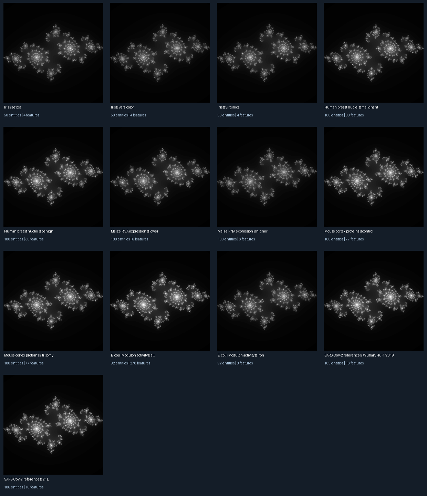

# Fractal Atlas

A dataset-independent Python toolkit for turning numerical datasets into **explorable Julia-set fractal portraits**.

**Question that inspired it:** How can we visualize the complexity of genetic data through a single mathematical construct?

The first implementation is deliberately generic. Use feature tables from genomics, other sciences, or any numerical dataset, or import measured pairwise relationship values. **This is an artistic visualization and exploration method, not a scientific inference model.**

## Real biological data gallery

**13 fractal portraits from six real source collections**, spanning plants, mice, humans, bacteria, and SARS-CoV-2 references.



- [Full gallery and dataset provenance](results/gallery/README.md)
- [All portraits, manifest, and image comparisons](results/gallery/)
- [Interactive comparison HTML](docs/gallery/index.html) (download to open, or enable GitHub Pages from main `/docs`)
- [Reproducible experiment source](scripts/run_gallery.py)

All images use the **same Julia formula, mapping, and rendering settings**. They illustrate how different numerical inputs change an artistic visualization; they do not measure biological similarity. Input modalities and feature counts vary, so comparisons are exploratory rather than controlled cross-species tests.

To regenerate from public sources (the original datasets are **not** committed to this repository):

```bash
python -m pip install -e '.[gallery]'
python scripts/run_gallery.py
```

## Controlled feature- and entity-count experiments

Seven additional portraits vary the input size while preserving the dataset and fractal rule: mouse cortex protein measurements at 8, 24, 55, and 77 features (180 observations), and maize expression at 64, 128, and 180 genes (six features).

- [Portraits and reproduction details](results/ablations/README.md)
- [Input-size experiment contact sheet](results/ablations/contact_sheet.png)

These variations show sensitivity of the artistic encoding to the chosen inputs, not proof of biological complexity.

## Install

Python 3.10+:

```bash
python -m pip install -e .
```

## Run the example

```bash
fractal-atlas -c examples/config.yaml -o outputs/example
```

Open `outputs/example/index.html`. The export is an offline, self-contained HTML explorer. `preview.png` is a grayscale Julia-set rendering, and `summary.json` contains summary metadata.

## Configure your own dataset

Example feature table:

```csv
id,expression,chromatin,variation
GeneA,0.4,1.7,0.02
GeneB,0.2,1.1,0.03
GeneC,0.9,1.5,0.09
```

Example `config.yaml`:

```yaml
name: My dataset
data:
  path: features.csv
  kind: features
  id_column: id
  columns: [expression, chromatin, variation]
  missing: median
  normalization: zscore
  similarity: cosine
  max_cells: 4000000
render:
  max_iter: 100
```

Feature tables may be CSV, TSV, or Parquet (install optional `.[parquet]`). Other similarity choices are `pearson` and `rbf`.

For supplied relationships, use columns `source,target,value`, with `data.kind: relationships`. Customize the three column names with `pair_source_column`, `pair_target_column`, and `pair_value_column`, and choose `symmetric: false` for directional data.

## Explore

- **Data navigation:** Click a quadrant of the relationship grid to select smaller regions until reaching one pair.
- **Math zoom:** Zoom into the Julia-set image without changing the selected data.
- **Traceability:** Inspect original entity IDs and pair scores at the final data level.
- **Fixed mapping:** Regional means and standard deviations determine Julia parameters according to the same rule.

See [Technique](docs/TECHNIQUE.md) for the equations, interpretation, and limitations.

## Development

```bash
python -m pip install -e '.[dev]'
python -m pytest -q
```

CI executes on Python 3.10–3.12.

## Status and privacy

**v0.1 public prototype.** More advanced controls, additional fractal families, large-data storage, and extensive real-world comparisons remain future improvements.

Feature-based similarity does **not** establish genetic interaction or causation. Fractal magnification creates more mathematical detail, **not additional observations**.

**The exported HTML embeds scores, identifiers, and feature measurements.** Do not publish an explorer containing confidential data.

MIT licensed.
